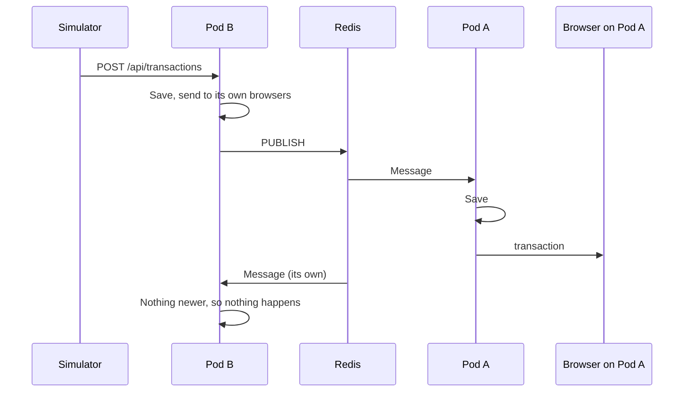

# Backend: running as many instances

How the API behaves with several replicas, and how to build and deploy it. See the [root README](../README.md) for running it locally and the API reference.

## The problem

With 5 replicas behind a load balancer, each request lands on one pod. An agent's browser holds a WebSocket to Pod A, and a transaction POSTed to Pod B never reaches it. Each pod's store is also its own memory, so a refresh that lands on another pod would show different history.

## The solution: Redis Pub/Sub

Every pod connects to Redis. Whichever pod receives a POST applies it locally, then publishes it. Every pod hears the message, saves it to its own store and sends it to its own clients.



The code is one class, [`RedisSync`](FinancialMonitor.Api/RedisSync.cs). It's off unless `ConnectionStrings:Redis` is set, so a single instance needs no Redis.

**Why the pods agree.** The same rule handles everything: only a strictly newer `timestamp` changes a row. Hearing your own message is a no-op, so there's no need to track which pod sent what. Updates that reach pods in different orders still end on the same status.

**Why there are no sticky sessions.** The client skips SignalR's negotiate request and opens a WebSocket directly, so one connection is one request to one pod.

**When Redis is down.** A POST still returns `202` straight away and the transaction is saved on the pod that received it. The failed publish is logged. Pods can start before Redis does, and they subscribe once it's reachable.

This was checked with two containers from this image, running read-only and non-root with all capabilities dropped: pods started before Redis synced about a second after it came up, and 200 concurrent POSTs split across both pods gave 200 distinct messages to a client on each.

## Limits

- **History is in memory.** A pod restart loses that pod's history, and a rolling deploy replaces every pod, so it loses all of it.
- **Late starters have partial history.** Redis doesn't keep messages, so a new pod only knows what arrives after it starts. Live updates aren't affected.
- **An outage isn't replayed.** Anything published while Redis is down never reaches the other pods.
- **Every pod does every write.** Adding pods adds capacity for connections, not for transactions.
- **Redis is a single point of failure in these manifests**, though not a capacity problem at this scale. At 50 pods it holds about 100 connections against a default limit of 10,000. At a hypothetical 1,000 transactions per second it delivers about 50,000 small messages per second. These are estimates, not measurements.

## Upgrade path

Each step is only worth taking when the limit above it starts to matter:

1. **Managed Redis or Sentinel** for automatic failover. Only the connection string changes.
2. **Keep the latest transactions in Redis** so a new pod can load them on startup, which closes the late-starter gap.
3. **A shared Postgres** as the durable record, so pods stop holding everything and history survives deploys.
4. **Kafka or NATS** instead of Redis Pub/Sub, if messages must be replayed after an outage or volume outgrows one Redis.

## Try two instances locally

```bash
docker run -d --name redis -p 6379:6379 redis:7-alpine
```

In two terminals, from the repo root:

```bash
ConnectionStrings__Redis=localhost:6379 dotnet run --project backend/FinancialMonitor.Api --no-launch-profile -- --urls http://localhost:5081
```

```bash
ConnectionStrings__Redis=localhost:6379 dotnet run --project backend/FinancialMonitor.Api --no-launch-profile -- --urls http://localhost:5082
```

Connect a client to one instance and POST to the other, or run the automated version:

```bash
TEST_REDIS=localhost:6379 dotnet test backend/FinancialMonitor.sln
```

## Docker

```bash
docker build -t financial-monitor-api:latest backend
```

The build has two stages: the SDK image compiles, and only the published output goes into `aspnet:8.0-alpine`, which gives a 164MB image. Restore has its own layer so code changes don't download packages again. The container runs as a non-root user on port 8080 and needs no writable disk.

## Kubernetes

```bash
kubectl apply -f backend/k8s
```

| File | What it creates |
|---|---|
| `deployment.yaml` | 5 API replicas with `/health` probes and resource limits, non-root with a read-only filesystem |
| `service.yaml` | A LoadBalancer on port 80 |
| `redis.yaml` | One Redis with persistence off, because it only relays messages |

The manifests pass `kubeconform --strict`, but they haven't been run on a real cluster. The image name has no registry, so push it to one or load it into your cluster first (for example `kind load docker-image financial-monitor-api:latest`).

The frontend isn't deployed here. In production, serve its build from the same origin as the API, for example through an ingress.
